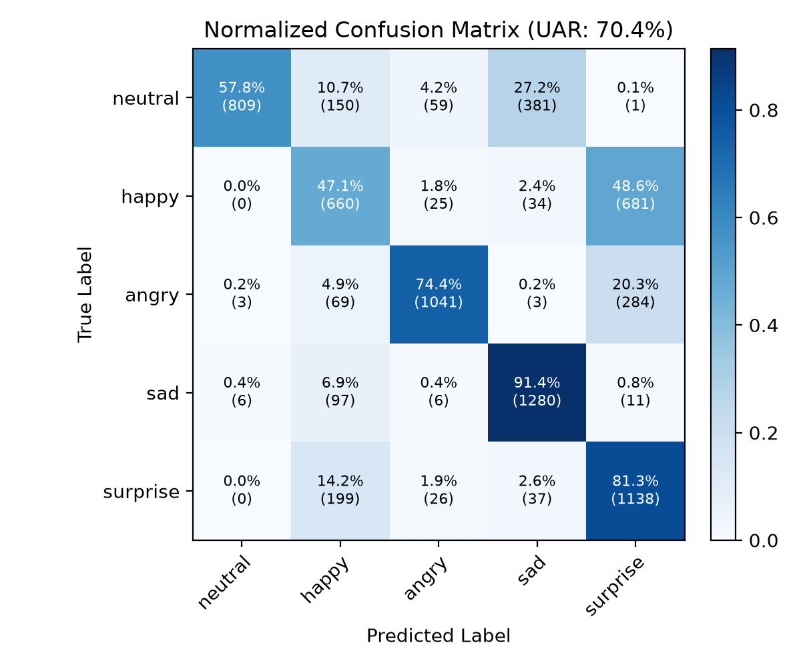
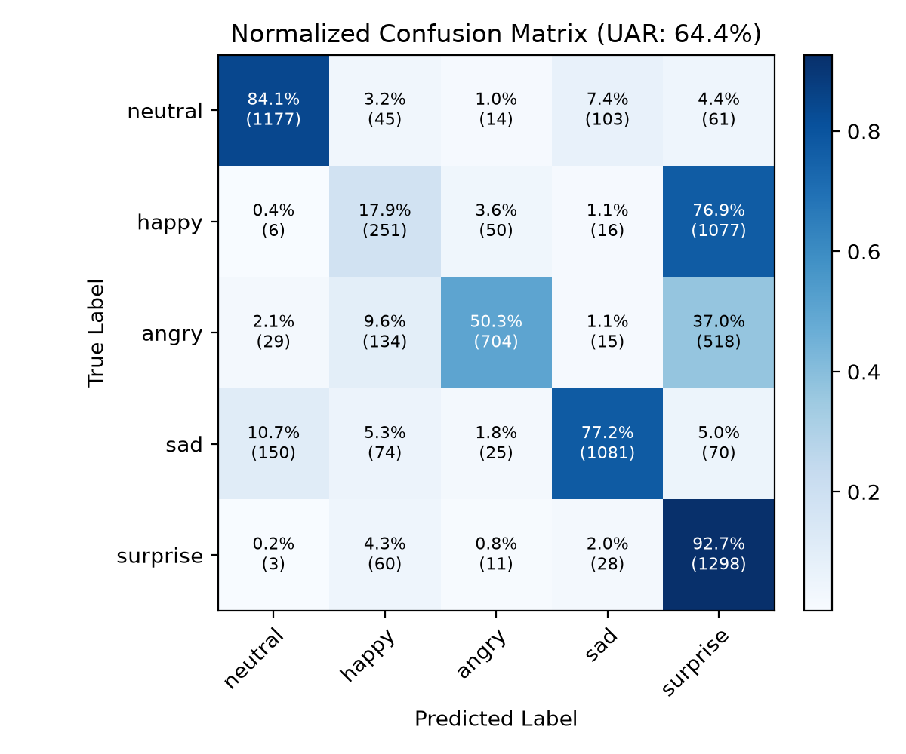
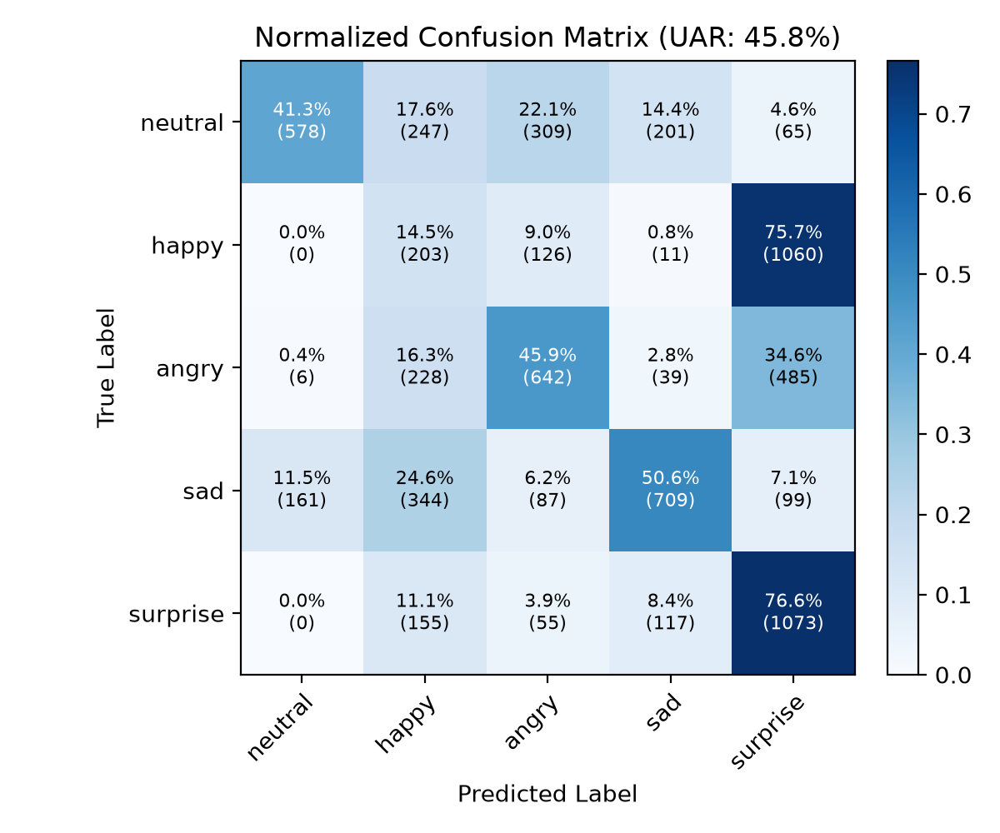

# Speech Emotion Recognition (SER) Pipeline

End-to-end speaker-independent Speech Emotion Recognition (SER) pipeline built for the **Emotion Speech Dataset (ESD)**, adhering strictly to the design blueprint (`blueprint_ser_pipeline.md`).

---

## 1. Features & Architecture

- **Classes**: 5 emotions (`neutral`, `happy`, `angry`, `sad`, `surprise`).
- **Input**: 16 kHz mono `.wav`, silence-trimmed (`top_db=30`), peak normalized, 4-second fixed window (random crop for training, center crop for evaluation).
- **Speaker-Independent Splitting**: Strict Leave-Speakers-Out splits generated via `src/data/make_split.py` (`fixed`, `stratified`, or `kfold` Group K-Fold).
- **Automated Anti-Leakage Verification**:
  - Verification of no speaker overlap across splits (`train`, `val`, `test`).
  - Detection of path and MD5 hash duplicates.
  - Verification that all 5 classes are present in every split.
  - Language representation checks (`zh` vs `en`).
  - Procedural anti-leakage guarantees (scalers fit only on train, augmentations only on train, tuning only on val).
- **Three Modeling Pathways**:
  - **Path A (Baseline)**: Handcrafted acoustic features (40 MFCCs + deltas + delta-deltas, F0, RMS energy, spectral features, summary statistics) + StandardScaler + SVM (RBF) / Random Forest.
  - **Path B (CNN)**: Log-Mel Spectrogram (80 mels) + SpecAugment + ResNet Conv2D blocks + Global Average Pooling + Linear head.
  - **Path C (SSL Pretrained)**: Pretrained WavLM (`microsoft/wavlm-base-plus`) / wav2vec2 with frozen CNN encoder and temporal mean pooling head.
- **Evaluation Module (`src/metrics.py`)**:
  - Primary metric: **UAR (Unweighted Average Recall / Balanced Accuracy)**.
  - Secondary metrics: WAR (Accuracy), Macro-F1, Weighted-F1, MCC, Cohen's Kappa, ECE (Expected Calibration Error), Log Loss, Top-2 Accuracy, Multiclass ROC-AUC (OvR macro).
  - Confusion Matrix (counts & row-normalized percentage heatmap PNG).
  - Breakdown per speaker (`per_speaker.csv`) and per language (`per_lang.csv`).
  - **Subject-level 95% Bootstrap Confidence Intervals** (resampling speakers with replacement).
  - Cross-corpus evaluation helper with label restriction (`restrict_labels`).
- **Inference (`src/predict.py`)**:
  - Sliding-window inference (4s window, 2s hop, averaged softmax probabilities) for audio files of any length.

---

## 2. Hasil Evaluasi & Benchmark Eksperimen

Seluruh model dievaluasi pada **test set independen yang sama persis** sebanyak 7.000 ucapan dari 4 speaker yang belum pernah dilihat model (0001, 0002, 0012, 0019; seimbang 1.400 sampel per kelas).

### 2.1 Tabel Perbandingan 3 Jalur Model

| Metrik Evaluasi | Peluang Acak (Chance) | Jalur A: Baseline SVM (Handcrafted) | Jalur B: Log-Mel + CNN (ResNet) | Jalur C: Pretrained WavLM (Fine-tuned) 🏆 | Delta C vs Baseline |
|---|:---:|:---:|:---:|:---:|:---:|
| **UAR (Balanced Accuracy)** ⭐ | 20.00% | 45.79% | 64.44% | **70.40%** | **+24.61%** |
| **Weighted Accuracy (WAR)** | 20.00% | 45.79% | 64.44% | **70.40%** | **+24.61%** |
| **Macro F1-Score** | 20.00% | 45.45% | 63.01% | **70.41%** | **+24.96%** |
| **Matthews Correlation (MCC)** | 0.0000 | 0.3332 | 0.5839 | **0.6388** | **+0.3056** |
| **Cohen's Kappa** | 0.0000 | 0.3223 | 0.5555 | **0.6300** | **+0.3077** |
| **Top-2 Accuracy** | 40.00% | 72.74% | 84.09% | **94.63%** 🔥 | **+21.89%** |
| **Log Loss (Cross-Entropy)** | 1.6094 | 1.7664 | 0.9975 | **0.9184** | **-0.8480** |
| **Expected Calibration (ECE)**| - | 0.3068 | 0.0799 | **0.1506** | - |
| **Subject 95% Bootstrap CI** | - | [41.80% – 51.41%] | [62.17% – 66.71%] | **[60.66% – 78.37%]** | Signifikan |

---

### 2.2 Perbandingan Performa Per Kelas (F1-Score)

| Emosi | Support | Baseline SVM F1 | CNN / ResNet F1 | WavLM F1 🏆 | WavLM Presisi | WavLM Recall |
|---|:---:|:---:|:---:|:---:|:---:|:---:|
| **Neutral** | 1.400 | 53.89% | **85.14%** | 72.95% | **98.90%** | 57.79% |
| **Sad** | 1.400 | 57.25% | 81.80% | **81.66%** | 73.78% | **91.43%** |
| **Angry** | 1.400 | 49.03% | 63.88% | **81.42%** | **89.97%** | **74.36%** |
| **Surprise** | 1.400 | 51.32% | 58.68% | **64.75%** | 53.81% | **81.29%** |
| **Happy** | 1.400 | 15.75% | 25.56% | **51.26%** 🚀 | 56.17% | **47.14%** |

---

### 2.3 Visualisasi Matriks Konfusi (Test Set)

| Jalur C: WavLM (UAR: 70.40%) 🏆 | Jalur B: Log-Mel CNN (UAR: 64.44%) | Jalur A: Baseline SVM (UAR: 45.79%) |
|:---:|:---:|:---:|
|  |  |  |

---

### 2.4 Breakdown Bahasa & Speaker Unseen

| ID Speaker | Bahasa | SVM UAR | CNN UAR | WavLM UAR 🏆 | WavLM F1 |
|---|:---:|:---:|:---:|:---:|:---:|
| **0019** | `en` | 45.14% | 63.49% | **80.74%** 🔥 | **79.93%** |
| **0002** | `zh` | 54.40% | 66.11% | **76.00%** | **73.77%** |
| **0012** | `en` | 41.14% | 60.86% | **69.31%** | **70.40%** |
| **0001** | `zh` | 42.46% | 67.31% | **55.54%** | **49.50%** |
| **Rata-rata (en)** | `en` | 43.14% | 62.17% | **75.03%** | **76.12%** |
| **Rata-rata (zh)** | `zh` | 48.43% | 66.71% | **65.77%** | **64.19%** |

---

## 3. Directory Structure

```
ser-pipeline/
├── configs/
│   └── base.yaml                 # Configuration parameters
├── data/
│   ├── manifest.csv              # Full dataset manifest
│   ├── split.csv                 # Manifest with split assignments
│   ├── train.csv, val.csv, test.csv
│   └── split_report.json         # Distribution and anti-leakage report
├── src/
│   ├── data/
│   │   ├── make_split.py         # Split generator + anti-leakage checker
│   │   ├── dataset.py            # PyTorch Dataset + preprocessing
│   │   └── augment.py            # SpecAugment & waveform augmentations
│   ├── features/
│   │   ├── handcrafted.py        # 40 MFCC+F0+energy acoustic feature extraction
│   │   └── melspec.py            # Log-Mel Spectrogram extraction layer
│   ├── models/
│   │   ├── cnn.py                # ResNet/CNN on Log-Mel spectrogram
│   │   └── ssl_head.py           # WavLM/wav2vec2 SSL model with pooling head
│   ├── metrics.py                # Comprehensive metrics & reporting CLI
│   ├── train.py                  # Unified training loop for all 3 pathways
│   ├── evaluate.py               # Standalone checkpoint evaluator
│   └── predict.py                # Production inference (single file / folder)
├── tests/
│   └── test_split_metrics.py     # 16 unit tests for splits, leakage, and metrics
├── runs/                         # Experiment runs (reports, summaries, confusion matrices)
│   ├── baseline_svm/report_test/
│   ├── cnn_exp1/report_test/
│   └── wavlm_exp1/report_test/
├── reports/                      # Full Markdown evaluation report
├── requirements.txt
└── README.md
```

---

## 4. Quickstart Guide

### 4.1 Install Dependencies
```bash
pip install -r requirements.txt
```

### 4.2 Generate Speaker-Independent Splits
Generate stratified splits (balanced per language: 14 train / 2 val / 4 test):
```bash
python src/data/make_split.py --root "D:/datasets/archive/Emotion Speech Dataset" --out data --mode stratified --seed 42
```
Or generate Group K-Fold splits (5-fold cross-validation):
```bash
python src/data/make_split.py --root "D:/datasets/archive/Emotion Speech Dataset" --out data --mode kfold --k 5 --seed 42
```
Verify an existing split against leakage:
```bash
python src/data/make_split.py --verify data
```

### 4.3 Run Unit Tests
```bash
python -m pytest tests/test_split_metrics.py -v
```

### 4.4 Training Models

**Train Baseline A (Handcrafted + SVM):**
```bash
python src/train.py --model-type handcrafted --run-name baseline_svm
```

**Train Path B (Log-Mel + CNN / ResNet):**
```bash
python src/train.py --model-type cnn --run-name cnn_exp1 --epochs 10 --batch-size 16
```

**Train Path C (Pretrained WavLM fine-tuning):**
```bash
python src/train.py --model-type wavlm --run-name wavlm_exp1 --epochs 8 --batch-size 8
```

### 4.5 Standalone Evaluation
Evaluate any saved checkpoint on test data:
```bash
python src/evaluate.py --ckpt runs/wavlm_exp1/best.pt --csv data/test.csv --out reports/wavlm_test
```

### 4.6 Emotion Inference on New Audio
Predict emotion for a single audio file or directory:
```bash
python src/predict.py --ckpt runs/wavlm_exp1/best.pt --input "path/to/speech.wav"
```
Supports sliding-window aggregation for long audio clips.
